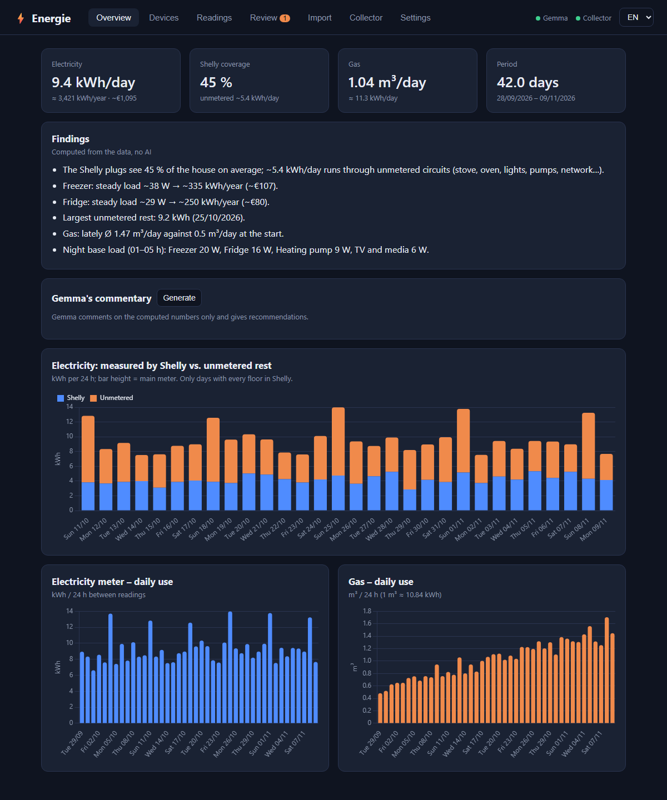
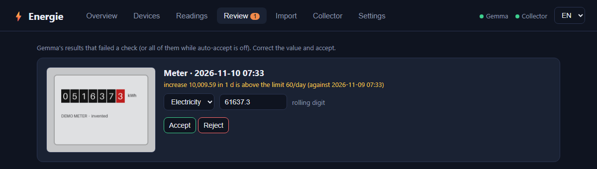
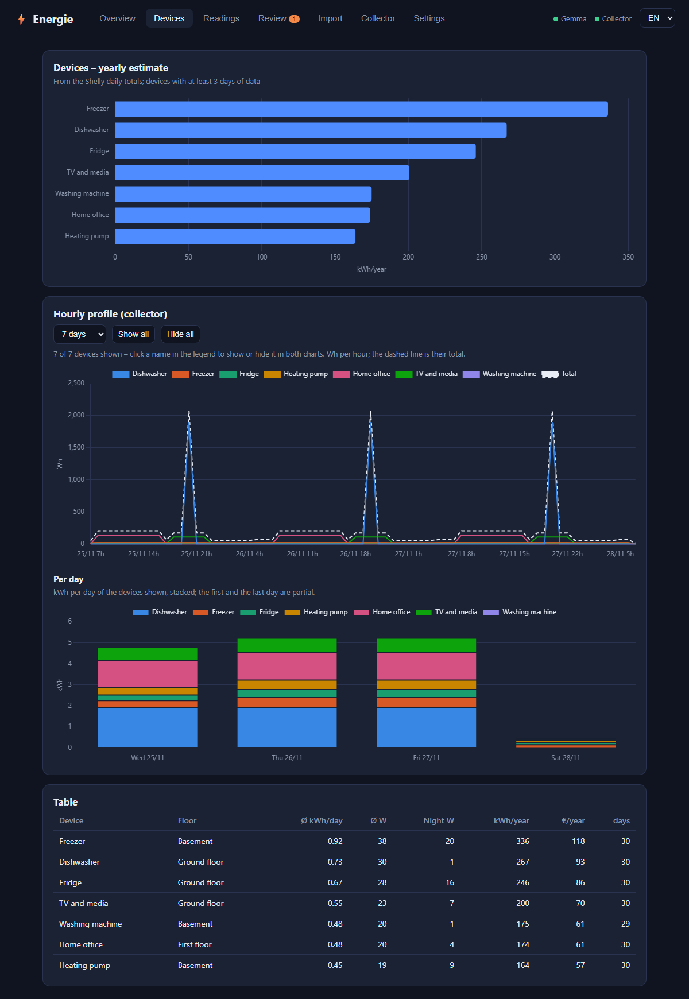

# Energie — local home energy analysis

Everything runs on your own computer and in your home network. No utility account, no cloud, no data
to third parties. Electricity and gas readings, Shelly smart plugs and a small collector on a
Raspberry Pi come together in one local web app, and a local AI model reads the meter photos.



<sub>All names and numbers in the screenshots are invented — they come from the demo
(`make demo`), never from a real house.</sub>

## How it works

- **SQLite database** (`energie.db`) — all data in a single file in the project folder. Back it up.
- **Web app** — runs at `http://localhost:8510`, for you only.
- **Gemma via Ollama (optional)** — a local AI model reads photos of the electricity and gas meter and
  screenshots of the Shelly app, and writes a commentary on the results. All numbers — daily use,
  coverage, yearly estimates, costs — are plain code; the AI never computes them.
- **Collector (optional)** — a small program on a Raspberry Pi or a NAS reads the Shelly plugs every
  minute around the clock and counts gas meter pulses; the app fetches its data on start
  ([collector/README.md](collector/README.md)).

```
 Shelly plugs ──LAN──► Raspberry Pi: collector (24/7) ──HTTP :8600──┐
 gas meter (reed) ─GPIO─►     collector.db                          │ sync on start
                                                                     ▼
 meter photos ───┐                                 PC: Energie (http://localhost:8510)
 screenshots ────┴──► Gemma (Ollama) ─► checks ─►  energie.db ─► analysis ─► dashboard + commentary
```

### Do I need the local AI?

No. The header shows whether Gemma is ready.

| Without Gemma (no Ollama) | Needs Gemma |
|---|---|
| Meter readings typed in on the *Readings* tab, or loaded from CSV | Readings from **photos** of the meters |
| Collector data: hourly profiles and night base load of every plug | 24 h totals from **screenshots** of the Shelly app |
| All charts, findings, yearly estimates and costs | The written **commentary** on the findings |

### Checks before anything is stored

Reading digits from a photo goes wrong now and then — a drum caught between two digits, a reflection
on the glass. Every result passes plain checks first: a meter never runs backwards against the readings
before and after it, the increase per day stays below a limit, and in a Shelly screenshot the devices
add up to their room and the rooms to the house. A result that fails a check waits on the *Review*
tab next to its photo, where you correct it with one click.



## Screenshots

| Devices |  |
|---|---|
|  | Every plug with its daily average, its night base load and what it costs a year. With the collector running, the hourly profile shows when a device actually runs. |

## Try it with invented data

```bash
make demo
```

starts the app at `http://localhost:8511` on a throwaway database in a new temporary folder, filled
with an invented house: six weeks of meter readings, a month of Shelly totals for seven devices on
three floors, three days of collector data, and one misread photo waiting for review. Your own
database and folders are never touched. Running Energie, the demo included, needs my permission — see
[License](#license).

## Author

**Taras Bulubas** — taras.bulubas [at] gmail.com

**Use of AI.** Claude (an AI assistant by Anthropic) was used to help write the code and the
documentation, following my specifications and decisions.

**License.** © 2026 Taras Bulubas. All rights reserved; see [License](#license).

## Development environment

Requires Python 3.12 and GNU make 3.82+. No conda: the project uses its own virtual environment
`.venv` in the project folder.

All dependencies are declared in [pyproject.toml](pyproject.toml):

| Group       | Packages                                 | Used for                         |
|-------------|------------------------------------------|----------------------------------|
| runtime     | `fastapi`, `uvicorn`, `python-multipart` | the web app and file uploads     |
| runtime     | `pandas`                                 | the analytics                    |
| runtime     | `pillow`                                 | photos: rotation, crops, bands   |
| runtime     | `requests`                               | the local Ollama API, the collector |
| extra `dev` | `pytest`, `httpx2`                       | tests                            |

The collector in `collector/` is not part of the package: it uses the Python standard library only and
runs on the Pi.

### Getting make on Windows

make is not part of Windows. Install it once, e.g. with

```bash
winget install ezwinports.make
```

or `choco install make` (from an administrator shell). Open a new terminal afterwards so that `make`
is on the `PATH`.

### Make targets

```bash
make venv
```

creates `.venv` with **Python 3.12** and installs the project in editable mode with the `dev` extra.
Running it again only reinstalls when `pyproject.toml` or the `Makefile` has changed.

| Target               | What it does                                               |
|----------------------|------------------------------------------------------------|
| `make` / `make help` | list the targets                                           |
| `make venv`          | create `.venv` and install the project with all extras     |
| `make test`          | run the tests with pytest                                  |
| `make run`           | start the app at `http://localhost:8510`; another port with `ARGS="--port 8520"` |
| `make demo`          | try the app on invented data at `http://localhost:8511` (your database is not used) |
| `make screenshots`   | retake the README screenshots in `docs/images` from the demo (headless Edge or Chrome) |
| `make clean`         | remove caches and build metadata                           |
| `make distclean`     | `clean` and remove `.venv`                                 |
| `make recreate`      | `distclean`, then `venv` — a fresh environment             |

### Without make

```bash
py -3.12 -m venv .venv
.venv/Scripts/python -m pip install -e ".[dev]"
```

(On Linux/macOS use `python3.12 -m venv .venv` and `.venv/bin/python`.)

### IntelliJ IDEA

See [docs/intellij.md](docs/intellij.md): register `.venv` as the project interpreter and use the
shared run configurations in `.run/` to run the tests and the app.

### Ollama + Gemma

Install [Ollama](https://ollama.com/download/windows) and pull the model:

```bash
ollama pull gemma4:26b-a4b-it-qat
```

The default is the 26B MoE model (about 15 GB, for a GPU with 16 GB of VRAM): reading the digits of a
meter needs accuracy more than speed. `gemma4:e4b` is faster and smaller; measure which one is good
enough on your own photos (below).

## Usage

The app speaks English, German and Slovak. It starts in your browser's language (English otherwise);
switch with the selector at the top right.

1. **Settings** — the folders with meter photos and Shelly screenshots, the prices and the gas factors
   from your bill (Zustandszahl and Brennwert turn m³ into kWh), and the collector address.
2. **Import** — put new photos and screenshots into the folders (or upload them on the tab) and press
   *Read with Gemma*. The time comes from the file name (`IMG_20261109_073012…`,
   `Screenshot_20261109-073012…`), else from the photo's EXIF data. Screenshots taken within ten
   minutes belong to the same 24 h window.
3. **Review** — what failed a check; correct and accept, or reject.
4. **Overview** and **Devices** — the results.

Hand-checked readings can be loaded from CSV (`meter_readings.csv`: `ts,meter,value,source_file,note`;
`shelly_readings.csv`: `window_end,source,scope,floor,name,energy_wh`):

```bash
.venv\Scripts\python -m energie load-csv data
```

### How well does a model read my meters?

With hand-checked CSV files in `data/` and the photos in the folders from the settings:

```bash
.venv\Scripts\python -m energie eval --model gemma4:e4b --only meter
.venv\Scripts\python -m energie eval --model gemma4:26b-a4b-it-qat
.venv\Scripts\python -m energie eval --single-pass --only meter     # without locating the counter first
```

prints the accuracy per model and writes every item to `data/eval-<model>-<time>.csv`. Nothing is
written to the database.

## Privacy

Meter photos show the meter number and the network operator's id; the readings show when somebody is
at home. Photos, screenshots and the database are processed only by your computer — deterministic
Python code and local Gemma via Ollama — and the collector only talks to the plugs in your own
network. Nothing is sent to the cloud. `.gitignore` keeps the database, the photos, the screenshots,
`data/` and the collector's configuration out of git. To keep the database outside the project folder:

```
set ENERGIE_DB=C:\Energie\energie.db
make run
```

## Settings (optional)

| Variable                | Default                   | Meaning                                     |
|-------------------------|---------------------------|---------------------------------------------|
| `ENERGIE_DB`            | `energie.db` in the project folder | the database file                  |
| `ENERGIE_PHOTOS`        | none                      | default folder with meter photos            |
| `ENERGIE_SCREENSHOTS`   | none                      | default folder with Shelly screenshots      |
| `ENERGIE_COLLECTOR_URL` | none                      | default collector address                   |
| `ENERGIE_GEMMA_MODEL`   | `gemma4:26b-a4b-it-qat`   | the Ollama model                            |
| `ENERGIE_OLLAMA_URL`    | `http://localhost:11434`  | the Ollama API                              |

The folder and collector variables are only defaults: a value saved on the *Settings* tab takes
precedence, and clearing it there falls back to the variable.

## Tests

```bash
make test
```

The tests run against a throwaway database in a temporary folder, never `energie.db`, with invented
values only. Ollama is switched off in them (Gemma's answers are fixed in the tests that need them),
and the collector is tested against invented Shelly devices on `localhost`.

## Layout

```
src/energie/
  app.py              FastAPI routes and static files
  db.py               schema, settings, CSV import
  analysis.py         every number: intervals, coverage, devices, base load, findings
  importer.py         photos and screenshots -> Gemma -> checks -> database or review
  gemma.py            Ollama client: meters in two passes, screenshots in bands, commentary
  sync.py             incremental download from the collector
  evaluate.py         accuracy of a model against hand-checked values
  cli.py              command line interface (python -m energie, demo, load-csv, sync, eval)
  demo.py             the invented house for the demo
  static/index.html   the whole frontend: markup, CSS, JS
  static/i18n/        UI strings in English, German and Slovak (en.json, de.json, sk.json)
  static/vendor/      Chart.js 4.4.4 with its MIT licence (no CDN)
collector/            the collector for the Raspberry Pi / NAS (standard library only)
deploy/               Ansible: a clean Raspberry Pi OS to a running collector (make deploy)
tests/                tests with invented data
scripts/              check_venv.py guards the Python version; readme_screenshots.py
                      takes the README screenshots from the demo
docs/                 IntelliJ setup, Raspberry Pi 4 setup; images/ holds the README screenshots (demo data)
.run/                 shared IntelliJ run configurations
Makefile              environment and task shortcuts
start.bat             double-click launcher
energie.db            your data (created on first run, never committed)
LICENSE               all rights reserved
```

## License

© 2026 Taras Bulubas. **All rights reserved.**

This repository — code, documentation and images — is published for viewing only. Using, running,
copying, modifying or distributing any part of it requires my prior written permission.

See [LICENSE](LICENSE) for the full terms.

**Would you like to use Energie?** I am glad to let people use it — ask me first by e-mail at
**taras.bulubas [at] gmail.com** (replace ` [at] ` with `@`), say briefly what you would like to use
it for, and you will get my answer in writing.
