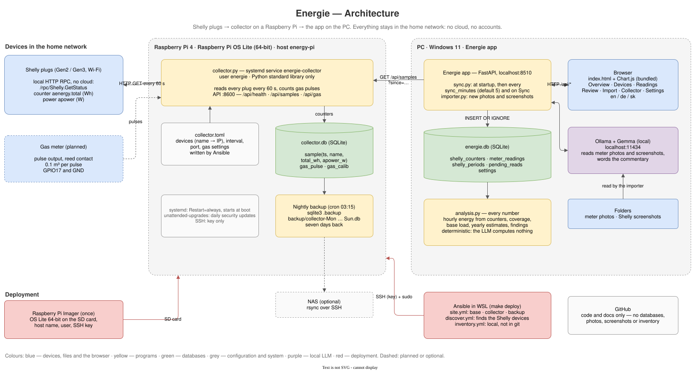
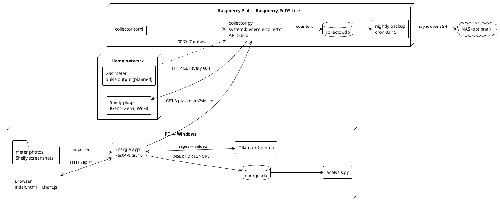
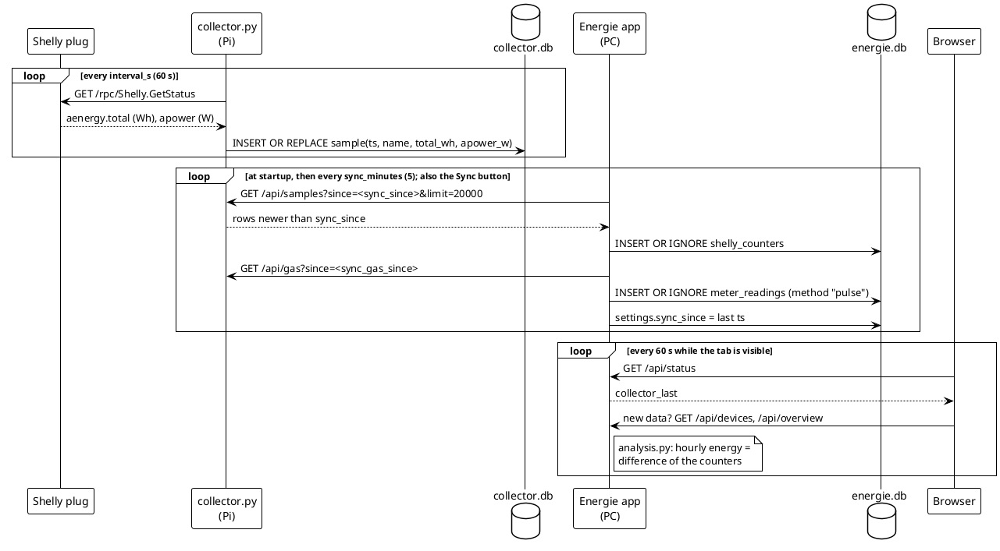
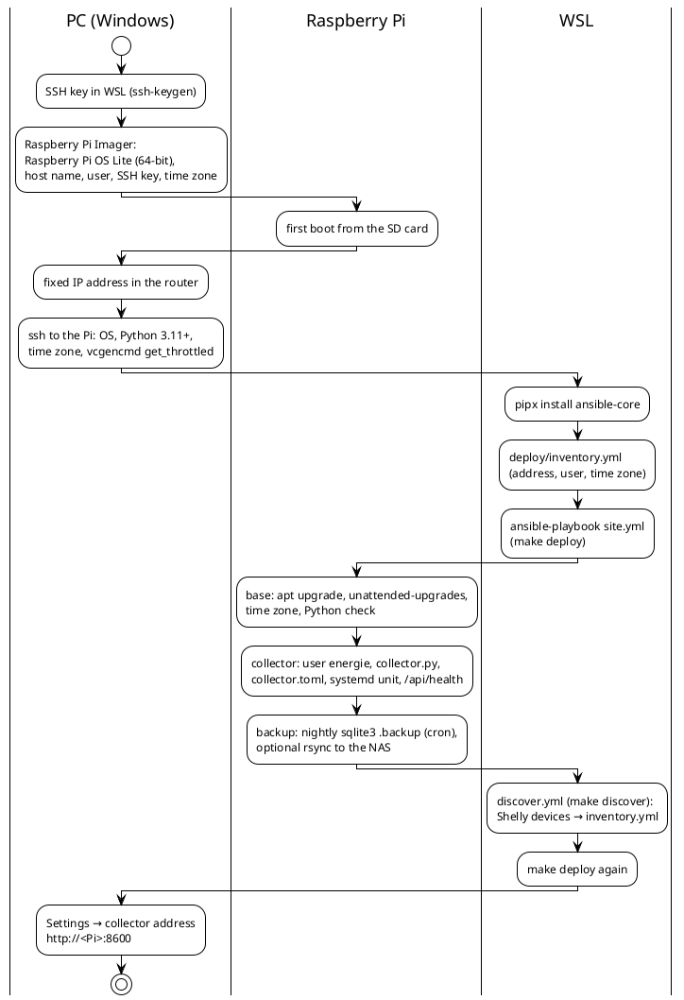

# Architecture

How Energie is put together: the parts, how the data gets from a Shelly plug to a chart, where
every piece of data is stored, and how the Raspberry Pi is set up. Everything runs on the user's
machines in the home network; no cloud service, account or third party is involved.



The picture is exported from [`diagrams/architecture.drawio`](diagrams/architecture.drawio), a
plain draw.io XML file (an `mxGraphModel`, uncompressed). Open and edit it in draw.io — the web app
[app.diagrams.net](https://app.diagrams.net), the desktop app or the *Diagrams.net Integration*
plugin of IntelliJ — or import it into Miro (*Upload → diagrams.net / draw.io*). After a change:

```bash
make diagrams        # re-exports every .drawio that changed to SVG (draw.io desktop; DRAWIO=... overrides the path)
```

The diagrams in the text below are PlantUML; IntelliJ shows them with the *PlantUML Integration*
plugin, and [plantuml.com](https://www.plantuml.com/plantuml) renders a pasted one.

## 1 · Parts



| Part | Where | What it does |
|---|---|---|
| Shelly plugs | Wi-Fi, home network | measure each device; a local HTTP API with a cumulative energy counter |
| `collector/collector.py` | Raspberry Pi, systemd service `energie-collector`, user `energie` | reads every plug once a minute, counts gas pulses, serves the data on port 8600; Python standard library only |
| `src/energie/app.py` | PC, `python -m energie`, port 8510 | web app and API; syncs with the collector at startup and every `sync_minutes` |
| `src/energie/sync.py` | PC | incremental download from the collector |
| `src/energie/importer.py` + `gemma.py` | PC, Ollama at `localhost:11434` | meter photos and Shelly screenshots → values, checked before they are stored |
| `src/energie/analysis.py` | PC | every number on screen; the LLM computes nothing |
| `src/energie/static/index.html` | browser | the whole UI, Chart.js bundled, English / German / Slovak |
| `deploy/` | PC (WSL) → Pi | Ansible: system, collector, backup |

## 2 · From a Shelly plug to a chart



1. **The collector reads counters, not power.** Every minute it asks each plug for
   `Shelly.GetStatus` (Gen2/Gen3; `/status` on Gen1) and adds up the cumulative energy of its
   channels: `aenergy.total` under `switch:0` on a switching plug, under `pm1:0` on a
   measuring-only plug. One row per plug and minute: `sample(ts, name, total_wh, apower_w)`, the
   time in the local time zone of the Pi (the same as the PC).
2. **An outage loses resolution, never kWh.** Energy in an hour is the difference of the counters
   (`analysis.counter_hourly()`); if the Pi or the Wi-Fi is down for a while, the next reading
   still contains everything used meanwhile. A counter that drops (the plug restarted) counts
   from 0 again.
3. **Sync is incremental and idempotent.** The app remembers the last time it fetched
   (`settings.sync_since`, `sync_gas_since`) and asks only for newer rows, in pages of 20 000;
   `INSERT OR IGNORE` makes a repeated fetch harmless. The background loop and the *Sync* button
   share one lock. While the PC is off, the collector keeps collecting; the next sync catches up.
4. **The page redraws itself.** Once a minute it asks `/api/status`; when the collector's last
   timestamp has moved, the open *Overview*, *Devices* or *Collector* tab reloads its data. Tabs
   with forms are left alone.
5. **The names** come from `collector.toml` (written from `deploy/inventory.yml`): the plugs do not
   store the names given in the Shelly app. Use the same names as in the app, so that the
   collector's counters and the totals read from screenshots belong to the same device.

Meter photos and Shelly screenshots take a second path: the importer finds new files, Gemma reads
the digits or the list of devices, `check_meter()` / `check_shelly()` test them, and they go into
`meter_readings` / `shelly_periods`, or into `pending_reads` for the *Review* tab.

## 3 · Where the data is stored

| Place | Contents | Backup |
|---|---|---|
| Pi, SD card: `/opt/energie-collector/collector.db` | `sample` (a row per plug and minute), `gas_pulse`, `gas_calib` | every night at 03:15 `sqlite3 .backup` to `/opt/energie-collector/backup/collector-Mon.db` … `-Sun.db` (seven days back); with `backup_rsync_target` also to the NAS |
| Pi: `/opt/energie-collector/collector.toml` | devices (name → IP), interval, port, gas settings | written by Ansible from `deploy/inventory.yml` |
| PC: `energie.db` (project folder, or `ENERGIE_DB`) | `shelly_counters` (synced counters), `meter_readings` (photos, manual, gas pulses), `shelly_periods` (24 h totals from screenshots), `pending_reads`, `settings`, `tariffs` (prices with the date they start) | a copy before every schema migration (`energie-backup-v<N>-<time>.db`) |
| Pi, when the app runs there (role `app`): `/var/lib/energie/` | `energie.db` as above, uploaded photos and screenshots | `energie-<day>.db` with the nightly collector backup; photos and screenshots to the NAS |
| PC: photo and screenshot folders (Settings, or `ENERGIE_PHOTOS` / `ENERGIE_SCREENSHOTS`) | the original images | the user's own |
| PC: `deploy/inventory.yml` | the Pi's address and user, the plugs' names and addresses | local only |
| Browser (`localStorage`) | language, hidden devices in the charts | — |
| GitHub | code, docs, README screenshots from the demo | — |

git ignores `energie.db`, `data/`, the photo and screenshot folders, `collector/collector.toml` and
`deploy/inventory.yml`: they show the meter numbers, the devices of the house and when somebody
is at home.

The collector never deletes old samples. A plug adds 1 440 rows a day; a card with a few
gigabytes free holds years of them. `collector_db` in the inventory moves the database to a USB
stick or SSD, which also spares the SD card.

## 4 · Deployment



- **Once, by hand** ([raspberry-pi.md](raspberry-pi.md)): the SD card with Raspberry Pi Imager,
  the first boot, a fixed IP address, a first SSH login.
- **Repeatable, with Ansible** ([deploy/README.md](../deploy/README.md)): `make deploy` on Windows
  runs `ansible-playbook` in WSL over SSH with the key; `--ask-become-pass` asks for the sudo
  password of the Pi's user. A second run changes only what differs; the service restarts only
  when its code, `collector.toml` or the unit changed. After a change to `collector.py` or the
  inventory: `make deploy` again.
- **On the Pi** systemd keeps the collector running (`Restart=always`, started at boot) and
  `unattended-upgrades` installs security updates every day. SSH accepts keys only.
- **Optionally the app on the Pi too** (role `app`, `energie_app_enabled`): installed from this
  checkout into a venv, the service `energie-app` on port 8510 in the home network, its data in
  `/var/lib/energie`, the collector at `127.0.0.1`. Gemma stays on a PC with a GPU
  (`app_ollama_url`); without it the numbers and charts work, reading photos waits.

## 5 · When something fails

| What | Effect | Recovery |
|---|---|---|
| A plug is offline | its row in the *Collector* tab shows the error; the others go on | none needed; the counter catches up |
| The Pi or its Wi-Fi is down | no samples meanwhile | the next sample contains the energy used; only the hourly detail of that gap is lost |
| The PC or the app is off | nothing is synced | the next start syncs everything since `sync_since` |
| The SD card fails | the Pi stops | write a new card, `make deploy`; the history is in `energie.db` on the PC up to the last sync, and in the NAS backup if set up |
| `energie.db` is lost | photos, reviews and settings are gone | the counters can be synced again from the collector (reset `sync_since`); photos can be imported again |

Open points: the nightly collector backup stays on the same SD card until `backup_rsync_target`
points to the NAS, and `energie.db` has no regular backup of its own yet.

---

© 2026 Taras Bulubas. All rights reserved. See [LICENSE](../LICENSE).
